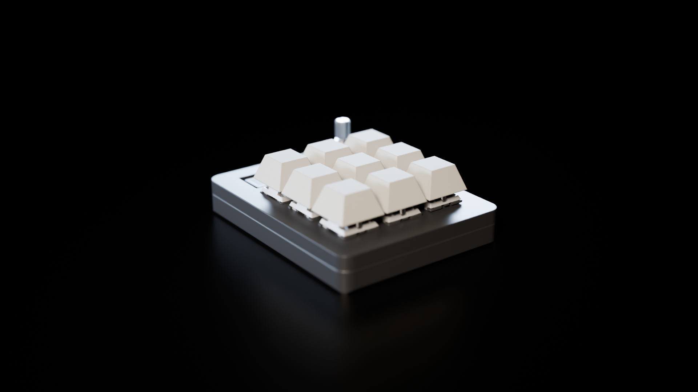
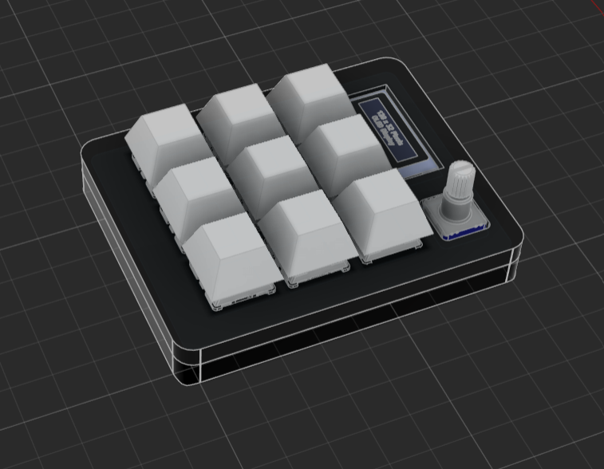
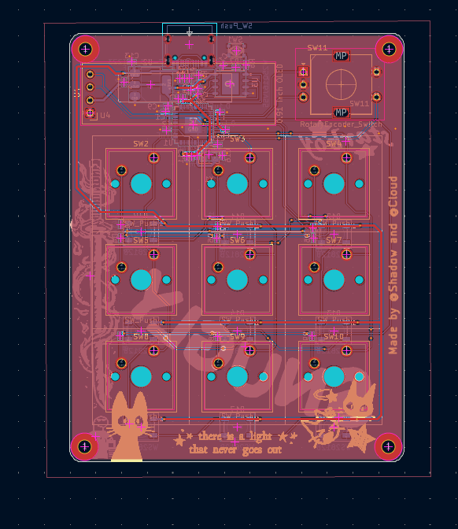
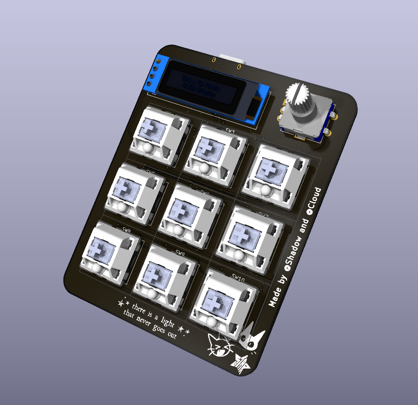
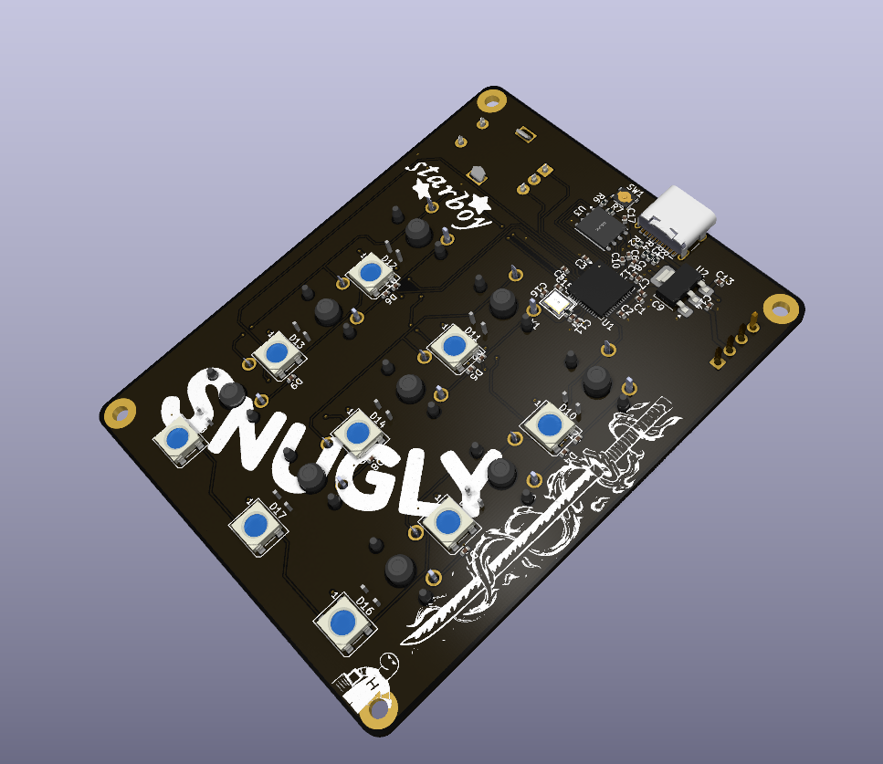
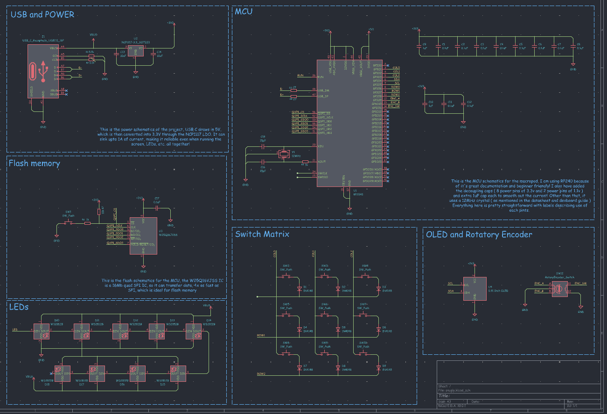

## Snugly 

# What is it?

its a macropad or better known as a hackpad, unlike normal pico or esp32 s3 we used barebones rp2040 which is a well known chip also used in pico, but we wired it bare bones giving us a more better control over our hardware and space (and also cheap)

it has 9 cherry mx keys with a WS2812B led under each one, a rotary encoder and a 0.91" OLED, powered over USB C. the case is 3d printed in 2 parts.

# why

macropad is REALLY useful when you have a 60% keyboard, also handy when you are bad at learning shortcuts 

# motivation

WE relly loved the hackpad in blueprint and decided to make one of our own but significantly cheaper and better!

# how does it work

using rp2040, the rust firmware inits and starts the system clock... the basic firmware currently shows total clicks on display and everytime you click a switch the led gets brighter and brighter

power comes in from USB C as 5V, an NCP1117 brings it down to 3.3V for the rp2040, and the 5V goes straight to the leds. the rp2040 boots from a 16Mbit W25Q16JVSS flash chip and runs off a 12MHz crystal. every key has a 1N4148 diode so the 3x3 matrix doesnt ghost, and the OLED talks over I2C ( SDA and SCL ).

# pictures

3D model of the whole thing

the PCB, front and back

schematic

# how to assemble

1. order the PCB with `production/snugly.zip` ( gerbers and drill files ). if you want it assembled too, `production/bom.csv` and `production/positions.csv` are the files for that, it covers everything smd on the board
2. solder the 9 cherry mx switches, the rotary encoder and the OLED, these are the through hole parts
3. print `production/snuglytop.stl` and `production/snuglybottom.stl`
4. put the PCB in the bottom half, put the top on and screw it through the 4 corner holes ( 2.5mm )
5. push the keycaps on and the knob on the encoder

if you want to change the case, the fusion file is in `CAD/snugly.f3d`

# how to flash

firmware is in `firmware/` and its written in rust.

1. install rust with rustup, then `rustup target add thumbv6m-none-eabi` and `cargo install elf2uf2-rs`
2. `cd firmware` and run `cargo build --release`
3. hold the BOOTSEL button on the board ( SW1 ) and plug in the USB C, a drive called RPI-RP2 shows up
4. run `elf2uf2-rs -d target/thumbv6m-none-eabi/release/firmware`, it copies the uf2 to the drive and the board restarts by itself

if you use nix there is a `flake.nix` in the folder that sets all of this up.

# BOM

| Part | Qty | Value / Part |
| ---- | --- | ------------ |
| RP2040 | 1 | QFN-56, 7x7mm |
| Flash | 1 | W25Q16JVSS ( 16Mbit quad SPI ) |
| Crystal | 1 | 12MHz |
| LDO | 1 | NCP1117-3.3 |
| USB C receptacle | 1 | 16 pin |
| BOOTSEL button | 1 | SMD push button |
| Cherry MX switch | 9 | |
| Keycap | 9 | |
| WS2812B LED | 9 | 5x5mm |
| Diode | 9 | 1N4148 |
| Rotary encoder | 1 | EC11 with switch |
| OLED | 1 | 0.91" I2C |
| Capacitors | 17 | 0.1uF x11, 1uF x2, 10uF x2, 15pF x2 ( all 0402 ) |
| Resistors | 7 | 5.1k x2, 27 x2, 1k x2, 10k x1 ( all 0402 ) |

and what it costs us:

| Item | Qty | Price |
| ---- | --- | ----- |
| PCBs | 5 ( MOQ ) | 4$ |
| PCBA | 2 ( MOQ ) | 52.99$ |
| Cherry MX switches | set of 10 | 3.70$ |
| Keycaps | set of 10 | 1.50$ |
| Rotary encoder | 1 | 0.30$ |
| 0.91" OLED | 1 | 3.50$ |
| Total | | 66$ |

# known issues

- the firmware is still very basic, it only reads one key and some leds right now, it doesnt scan the whole 3x3 matrix or drive the WS2812B leds yet, and `main.rs` needs a few fixes before it builds
- the unit test in `lib.rs` doesnt work, you cant really test hardware stuff like that so we left it

# credits

- Kai Pierra's custom devboard guide and the official rp2040 datasheet for the schematic
- the hackpad from blueprint for the idea
- @cloudglides for the firmware, the Orpheus bootup art and the zine
- rust crates : rp2040-hal, ssd1306, embedded-graphics
- KiCAD for the PCB and Fusion 360 for the case
